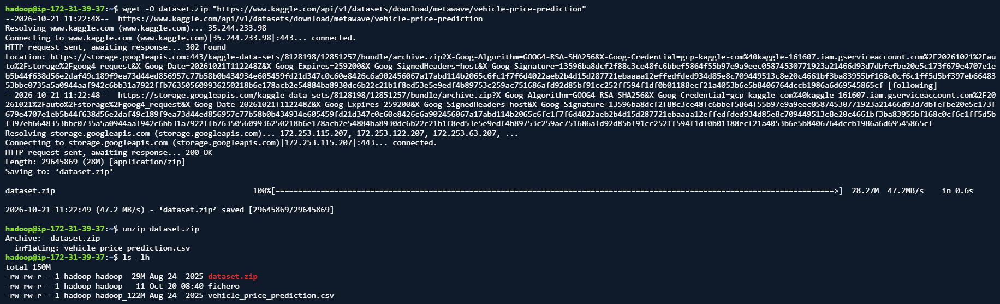
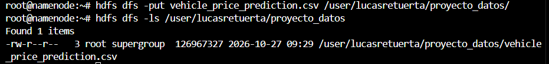
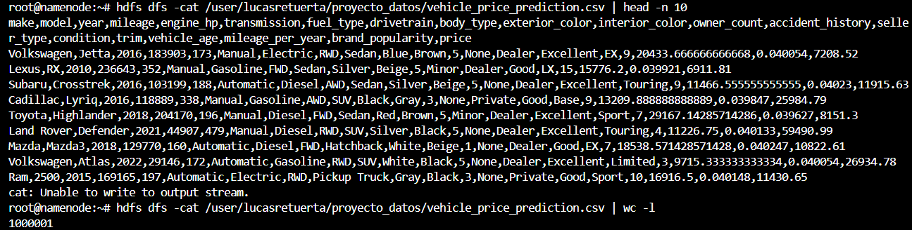
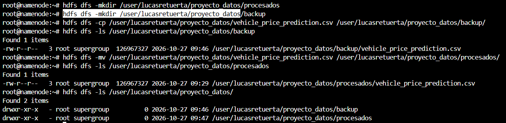
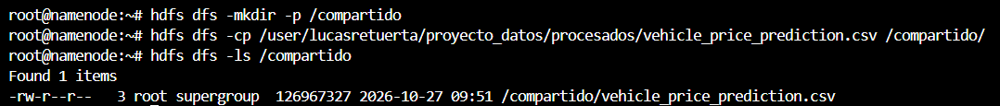
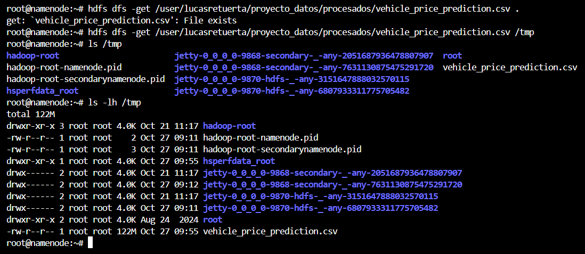
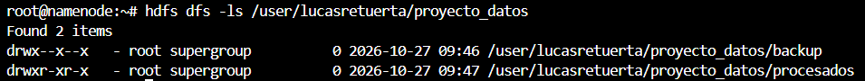
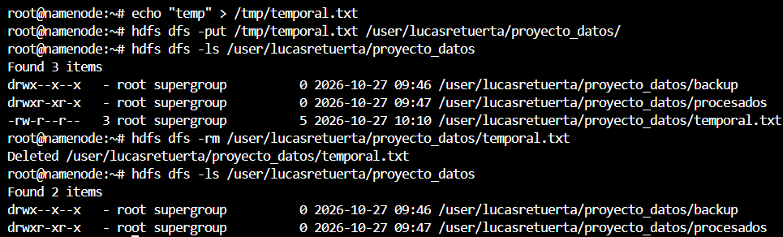

## Practica 202 - Uso del cliente HDFS

Parte 1

Parte 2

El enlace que estaba en la pagina del github no funcionaba, asique le pregunte a la IA si aun asi habia alguna forma de hacerlo con wget,  me dio el comando de la imagen, que sirve con el -0 para ponerle el nombre que quieras que le puse "dataset.zip" y con una url de una api donde esta el "Automotive Price Prediction Dataset".
Luego instale el unzip con el comando sudo apt install unzip para descomprimir el dataset y de ahi sale el csv.

Parte 3

Parte 4

Parte 5

Parte 6

Parte 7

Parte 8

